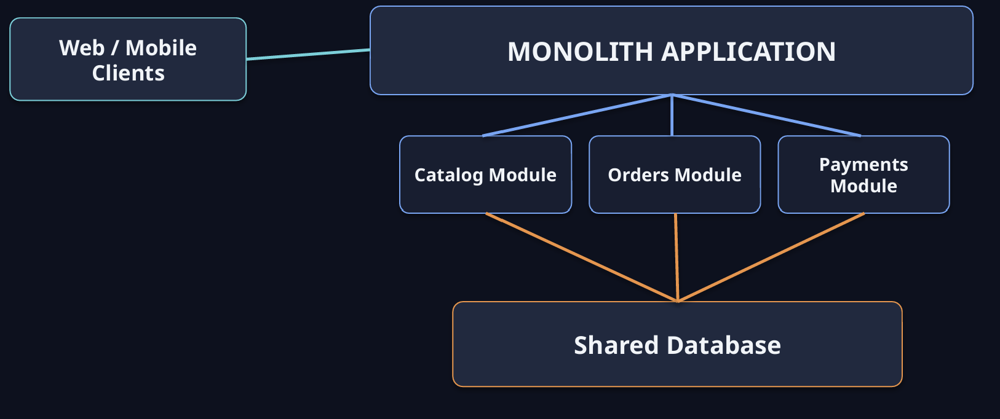
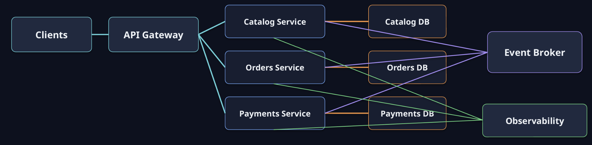
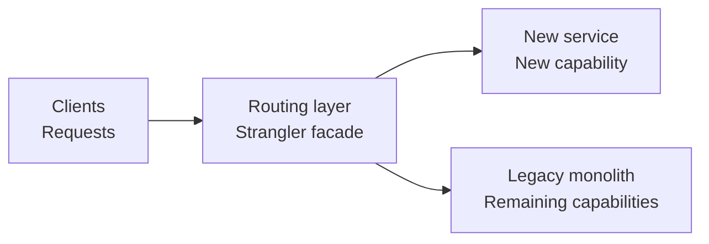
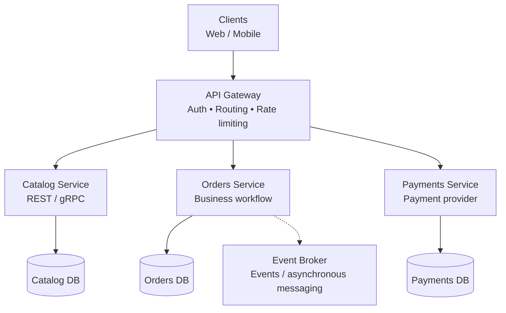
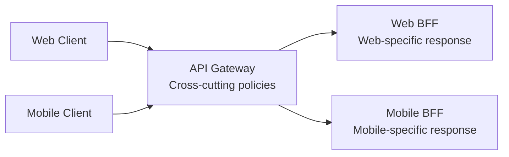
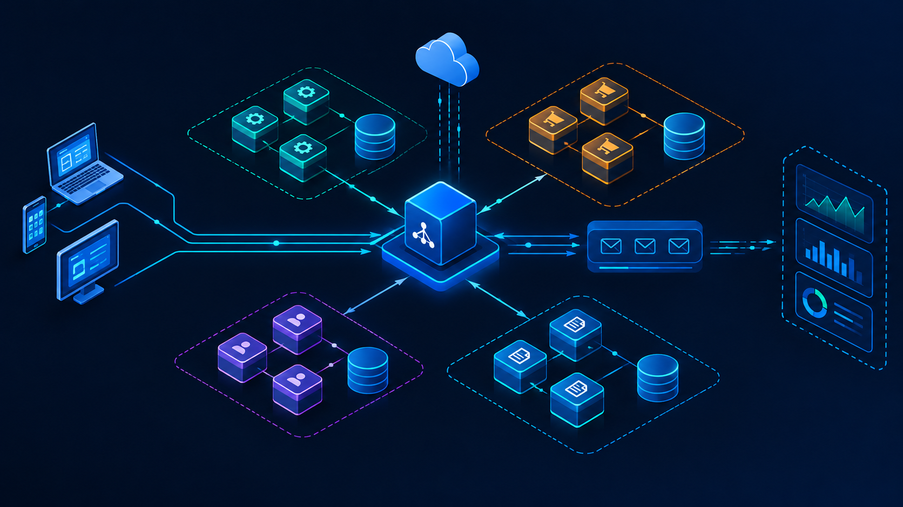

# Microservices

*Designing systems that evolve, scale and recover independently*

**Design of Information Systems and Databases 2026/2027**
Nenad Pantelić

---

## 1. Microservices

Microservices are small, autonomous services that work together and are modeled around a business domain. A microservice has a clear responsibility and exposes a clear API contract.

- **Size is not the metric.** A service is not defined by its number of lines of code.
- **Autonomy** means a service can be released independently.
- Each service can have its own technology stack, data model, persistence layer and idiomatic design.
- **Not a deployment trick.** Splitting a monolith into chatty network calls is not enough.
- Instead of a single monolith as a potential single point of failure, the system is a collection of cohesive services that communicate and evolve independently.

---

## 2. Principles of microservices

- Modeling around the business domain and more stable APIs.
- Culture of automation.
- Hiding implementation details.
- Decentralization of decisions and responsibilities.
- Independent deployment.
- Consumer-first approach.
- Isolation of failures.
- Observability.

---

## 3. Advantages of microservices

- Independent deployment of services and a decentralized architecture.
- Scalability per service.
- Rollout of new versions with reduced downtime.
- Detecting unwanted behavior before the old version is fully replaced.
- Support for multiple languages and technologies.
- Isolating a problem to a single component instead of a system-wide outage.
- Real-time load balancing.

---

## 4. Monolith vs. microservices

*Trade-offs*

**Modular monolith**

A single deployment unit.

- \+ Simple local calls and transactions
- \+ Easier refactoring across modules
- \+ Lower operational overhead
- − Scaling/deploying modules independently is harder

**Microservices**

Multiple services that can be deployed independently.

- \+ Independent scaling and release cadence
- \+ Clear ownership and freedom of technology choice
- \+ Failure isolation
- − Network and operational complexity; data consistency concerns

> Start with the simplest architecture that satisfies the constraints; split when a concrete reason appears.

---

## 5. Modular monolith

---

## 6. Microservices

- Gradual decomposition; not everything has to be extracted at once.
- During migration, the API Gateway can route some requests to the new services and the rest to the legacy monolith.
- Communication:
  - RPC / REST / gRPC: synchronous requests
  - Events via an Event Broker: asynchronous communication
  - Each service owns its own data store

---

## 7. Monolith → Modular monolith → Microservices

*A gradual path: first clear boundaries, then independent extraction where it brings value.*

| Monolith | Modular monolith | Microservices |
|---|---|---|
| One application | One deployable | Independently deployable services |
| Often a shared database | Modules with clear boundaries | API + owned data |

> Not every system has to reach microservices. Decompose capability by capability, and extract functionality by functionality.

---

## 8. Designing boundaries between services

*Vertical slices…*

**Orders**
- Order lifecycle
- Pricing snapshot
- Order status
- Order-owned data

**Payments**
- Payment authorization
- Capture / refund
- Payment status
- Payment-owned data

**Catalog**
- Product information
- Availability view
- Catalog-owned data

> A change in one capability should not routinely require coordinated changes and releases in other services.

---

## 9. Modeling around the business domain

- Do not organize the system only horizontally by layers (presentation, business logic, data storage).
- A horizontal change often cuts across several layers and teams and requires coordination.
- Vertical boundaries should follow the business domain and real functionality.
- The frontend can use a BFF (Backend for Frontend) tailored to that specific frontend.

---

## 10. Culture of automation

- Automate infrastructure and dev/test environments, as well as the management of production platforms.
- Automate testing.
- Continuous Delivery: treat every individual change as a release candidate.

---

## 11. Hiding implementation details

- If two services share a database, renaming a column can break one of them.
- Direct access to another service's database exposes its internal implementation; hide the database behind the owning service's API.
- Shape the API around the context and needs of consumers.
- It is easier to add data later than to remove it once consumers already rely on it.
- Keeping implementation details private allows services to evolve independently.

---

## 12. Contracts (interfaces) make autonomy possible

*Design for consumers*

- Treat APIs and events as products: document them, version them and monitor them.
- Hide internal schemas and persistence behind the interfaces the service controls.
- Prefer additive changes: measure adoption of the new changes before removing old fields/endpoints.
- Use consumer-driven contract tests to detect breaking changes in CI.
- Compatibility should be time-limited and explicit.

**Safer evolution**

Add → migrate clients/consumers → observe → remove old endpoints/contracts.

**Avoid**

Shared databases/schemas acting as undocumented cross-service APIs.

---

## 13. Decentralization

- Avoid moving business logic into central, overly smart infrastructure and message brokers.
- Principle: *dumb pipes, smart endpoints* — the infrastructure carries messages, and the business logic stays in the services.

---

## 14. Independent deployment

- If five services must always be deployed together, remove that coupling before adding new services.
- A host is an isolated environment: a physical machine, a virtual machine or a container.
- Multiple services on the same host can cause CPU contention and dependency conflicts.
- One service per isolated environment often makes management and scaling easier, but it carries an infrastructure cost.

---

## 15. Consumer-driven contracts

- The question: if I change a service, will I break its consumer?
- Run contract tests in CI that verify consumer expectations when the provider service changes.
- A contract should describe the interface that is actually used, not all internal details.

---

## 16. Coexisting endpoints and versioning

- To change an API, publish v2 while consumers still use v1.
- Give consumers time to move to v2, deploy them, and then remove v1 when it is no longer needed.
- Maintaining multiple versions of a service in parallel can multiply business-logic changes and complicate service discovery.

---

## 17. Consumer-first approach

- Provide clear documentation and stable contracts.
- Enable service discovery and reliable discovery of available instances.
- Example mentioned in the source material: HumaneRegistry.

---

## 18. Isolation of failures

- Distributed services depend on the network and can be hit by network partitions.
- More machines and processes increase the need for explicit resilience.
- A failure in one service should not exhaust resources or bring down the rest of the system.

---

## 19. Strangler pattern

- Put a strangler application in front of the existing monolith as a proxy.
- Route all incoming requests through it.
- For the extracted functionality, forward the request to the new service; forward the rest to the monolith.
- Gradually redirect functionality until all requests go to the new services.

---

## 20. Strangler pattern

*Route capabilities one at a time, strangling them out of the legacy implementation.*

> Migrate one capability at a time; use timeouts and isolation so that slow legacy paths do not exhaust the facade.

---

## 21. Fail slowly: the problem

- A slow downstream service can hold threads and connections until the strangler application's resources are exhausted.
- A request that waits too long can cause a cascading failure.
- It is essential to define timeouts and allow earlier, controlled failure (*fail fast*).

---

## 22. Bulkhead, Circuit Breaker and retry

- **Bulkhead:** separate resource pools for different downstream dependencies.
- **Circuit Breaker:** temporarily stops calls to a service that is showing errors, to give it time to recover.
- **Retry** is used selectively, with a limit and exponential backoff (jitter as well); retry without control can make an incident worse.
- For the rollout of a new version, it is possible to stop routing traffic to that version.

---

## 23. Observability: logs and metrics

- Centralized logs: the source material mentions Splunk, the ELK stack and Papertrail.
- Metrics and time-series aggregation: the source material mentions Graphite, Prometheus, New Relic and AppDynamics.
- The tools are examples from the presentation; the choice depends on needs, budget and the existing environment.

| Logs | Metrics | Tracing |
|---|---|---|
| Structured events | Latency percentiles | Cross-service spans |
| Request / trace IDs | Traffic, errors, saturation | Dependency timing |
| Useful context, not secrets | SLIs and SLOs | Bottleneck localization |

---

## 24. Tracing and chaos engineering

- A correlation ID is an identifier of a distributed request that is propagated through the affected services.
- Tracing helps reconstruct the path of a request; the source material mentions Zipkin.
- Chaos engineering deliberately tests system behavior under failures; the source material mentions Chaos Monkey.

---

## 25. Monolith vs. microservices

- Monolith: simplicity, easier consistency and inter-module refactoring.
- Microservices: partial deployment, potential for higher availability, preserving modularity, and different operating systems, languages, technologies and databases.
- Neither approach is universally better; the decision depends on business and operational needs.

---

## 26. Microservice design patterns

- Database per Service.
- Saga.
- API Gateway and Aggregator.
- Circuit Breaker.
- CQRS (Command Query Responsibility Segregation).
- Asynchronous messaging and Event Sourcing.
- Strangler pattern and decomposition patterns.

---

## 27. Database per Service

- The database is owned by a single service and other services do not access it directly.
- Services can choose different storage models: relational, non-relational or vector.
- Other services' data is obtained through its API or events.
- This reduces coupling and allows the data model to change independently.

---

## 28. A single physical database shared by multiple services

- A shared database is not the default pattern for microservices and can weaken scalability, resilience and independence.
- It can be acceptable in certain situations.
- If a physical database is shared, establish logical boundaries: separate schemas and read/write access only for the owning service.

---

## 29. Saga pattern

- A saga is a sequence of local transactions that together implement a business flow across multiple services.
- Example: creating an order and reserving the customer's credit in separate stores.
- Instead of one global transaction, successive local transactions and compensating actions are used.
- Two approaches: *orchestration* (a coordinator) and *choreography* (services react to events).

1. **Create order** — Order = PENDING
2. **Reserve stock** — Inventory reserved
3. **Charge payment** — Payment accepted
4. **Confirm order** — Order = CONFIRMED

> If the payment fails: return the item to stock → cancel the order (compensating actions).

Coordination styles:

- Orchestration: a coordinator manages the steps
- Choreography: services react to events

---

## 30. API Gateway pattern

- The API Gateway is a single entry point and reverse proxy between clients and microservices.
- The client does not need to know how many services exist or how they are split.
- It can handle authentication, SSL/TLS termination, caching, rate limiting and routing. It can also aggregate results from multiple services.
- A single entry point simplifies security controls, but it must not become a centralized monolith of business logic.

| Clients | Gateway / BFF | Services |
|---|---|---|
| Web app | Routing | Orders |
| Mobile app | Authentication | Catalog |
| Partner API | Rate limiting | Identity |
| | Client-specific aggregation | Payments |

> Let business decisions stay in the services that own them; do not build a new monolith out of the gateway.

---

## 31. CQRS

- Command Query Responsibility Segregation separates the models for writing (commands) and reading (queries).
- The write model manages state changes; the read model exposes projections optimized for queries.
- Reading and writing can be optimized independently for performance and security.
- Complexity and eventual consistency are additional costs; CQRS is not needed for every service.

---

## 32. Asynchronous messaging

- When the caller does not need to wait for a response, communication can be asynchronous and event-driven.
- A message queue or Event Broker connects services without tight synchronous dependency.
- Advantages: better absorption of load spikes and more flexible workflows.
- Trade-off: eventual consistency, duplicates, message ordering, and the need for idempotent handlers.

---

## 33. Event Sourcing

- Instead of storing only the current state, a sequence of events that changed the entity's state is stored.
- The current state can be reconstructed by replaying the events.
- An event store and an Event Broker have different roles, although the same technology can sometimes take part in both.
- Useful when the history of changes is key; it increases the complexity of modeling, projections and migrations.

---

## 34. Decomposition patterns

- Decomposition splits a monolith into smaller units that are easier to manage.
- Three approaches are covered in the source: by business capability, by subdomain and by transaction.
- Boundaries should be based on cohesion, data ownership and the way things change, not just on technical layers.

---

## 35. Decomposition by business capability

- Example e-commerce domain: catalog, inventory, orders and shipping.
- Each business capability encompasses functionality that together achieves a business goal.
- Suitable when there are many related functions and business processes change often.
- Smaller, focused units enable faster iteration and experimentation.

---

## 36. Decomposition by subdomain

- Suitable for large and complex applications with a lot of business logic, workflows and data models.
- Separating subdomains makes code easier to manage and development more independent.
- Example from the source: a blog in a separate subdomain can be separated from the core business logic.

---

## 37. Decomposition by transaction

- Suitable for transactional flows that involve multiple components or services.
- Example from the source: processing an insurance claim can involve communication with both the customer service and the claims service.
- Carefully define transaction boundaries, consistency and compensation when there is no global ACID transaction.

---

## 38. What decomposition looks like: capability by capability

- Start from business capabilities: Catalog, Inventory, Orders, Payments, Shipping.
- For each capability, define the responsibility, API, data and the team that maintains it.
- A boundary is not just a folder or a service class — it is a boundary of change, ownership and contract.
- Do not create a service for every table or extract components for no reason.

---

## 39. What decomposition looks like: functionality by functionality

- Extract specific functionalities one by one, measuring risk and value.
- Example: first catalog search, then order creation, then payment.
- Each migration should have clear acceptance criteria, metrics and a rollback plan.
- Do not move an entire domain at once if only one functionality can be safely redirected.

---

## 40. Microservices reference architecture

Observability: Logs • Metrics • Traces

---

## 41. API Gateway and BFF

> The API Gateway should not become a central monolith of business logic. A BFF is an optional layer for the experience of a specific client.

---

## 42. RPC, REST and asynchronous communication

| Synchronous | Asynchronous | Data ownership |
|---|---|---|
| REST / RPC / gRPC | Event Broker / Queue | API or events, not DB access |

**Synchronous call:** simple request-response, but the caller depends on the availability of the downstream service.
- Good for: an immediate response, queries and commands with clear response needs.
- Cost: the caller waits; latency and failures propagate; runtime coupling.

**Asynchronous event:** weaker temporal coupling, but idempotency, a retry policy and handling of eventual consistency are needed.
- Good for: decoupled workflows, fan-out, buffering, background work.
- Cost: eventual consistency, retries, duplicates, complexity — event ordering and tracing.

> Use the simplest communication mechanism that satisfies the requirements and constraints!

---

## 43. Data ownership and integration

- Each service is the source of truth for its own data.
- For another service's data, use its API or events, not a direct query against its database.
- For reliable publishing of events, consider the Transactional Outbox.
- For duplicates, use idempotent consumers; for read-heavy scenarios, consider projections/CQRS.

---

## 44. Resilience: behavior under failure

- A timeout limits how long we wait for a downstream service.
- Retry only for transient errors, and with a limit, jitter and exponential backoff.
- A Circuit Breaker cuts off calls to a faulty dependency; a Bulkhead isolates resources.
- A fallback must have sensible business behavior; do not silently mask inconsistent data.

---

## 45. Resilience: fail fast, isolate, recover

| Timeouts | Retries | Circuit breaker | Bulkheads |
|---|---|---|---|
| Put a time limit on every operation. | Retry only temporary errors; use backoff, jitter and limit the number of attempts. | Stop calling unhealthy dependencies; allow controlled recovery probe calls. | Limit concurrency and resources per dependency to control saturation. |

> Retries without timeouts and limits can increase a service's unavailability.

---

## 46. Deployment and rollout

- Automated build, tests, security checks and deployment pipeline.
- Canary or rolling deployment limits the risk of a new version.
- Feature flags and quick rollback make a controlled rollout easier.
- Independent deployment is a real measure of autonomy — if all services must be deployed together, the boundaries are not independent enough.

---

## 47. Independent deployment requires automation

- Automated build, tests, security checks and artifact creation.
- Tests: consumer contract tests and integration tests at the real boundaries.
- Progressive delivery: canary/rolling rollout, health checks, fast rollback.
- Configuration and secrets management outside the application.
- Resource limits, health probes and "recoverable" infrastructure.
- Ownership includes on-call and operational readiness.

**Release test:** can a single service be deployed without coordinating the release of all the other services?

---

## 48. Migration plan using the Strangler pattern

1. Map the monolith and choose one business capability with a clear boundary.
2. Put in a proxy/routing layer and keep the existing behavior as the default.
3. Implement the new functionality behind a contract and compare the results.
4. Redirect part or all of the traffic, monitor the metrics and keep a rollback.
5. Remove the legacy implementation only when it is no longer in use.

---

## 49. What to measure before and after extraction

- Lead time for changes and deployment frequency.
- Change failure rate, MTTR and availability of key flows.
- Latency (p50/p95/p99), error rate, saturation and infrastructure cost.
- The number of coordinated deployments between services and the frequency of changes that cross boundaries.

---

## 50. When not to move to microservices

- The team is small and can efficiently ship as a single deployable.
- Domain boundaries are not yet clear or the business model changes quickly.
- There are no automated tests, CI/CD, monitoring or operational discipline.
- Distributed systems would add more network, data and operational problems than they would solve.

---

## 51. Before splitting a service

- Is there a clear business capability (functionality) and a bounded context?
- Can the service have its own data and expose a stable contract (API)?
- Does it need different scaling, security or release cadence?
- Can the team deploy, monitor and support it independently?
- What about latency, failure modes, consistency, cost…?
- Would a modular monolith solve the problem better, with less complexity?

> **Rule for splitting:** split because of autonomy, clear ownership or scaling — not because the codebase is big.

---

## 52. Practical checklist

- Does every business capability have clear ownership?
- Can services be tested and deployed independently?
- Are API contracts versioned and tested?
- Are there timeouts, a retry policy, a Circuit Breaker and resource isolation?
- Are correlation/trace IDs propagated, and are there alerts?
- Is there a rollback plan and evidence that the extraction brings a measurable benefit?

> **Key question:** can a team change, deploy and operate a single capability with limited coordination? Also consider a modular monolith.

---

## 53. The goal is autonomy!

Microservices trade local simplicity for independent ownership and their own lifecycle, at the cost of the complexity of distributed systems.

Choose boundaries carefully. Automate relentlessly. Design with failures in mind.
